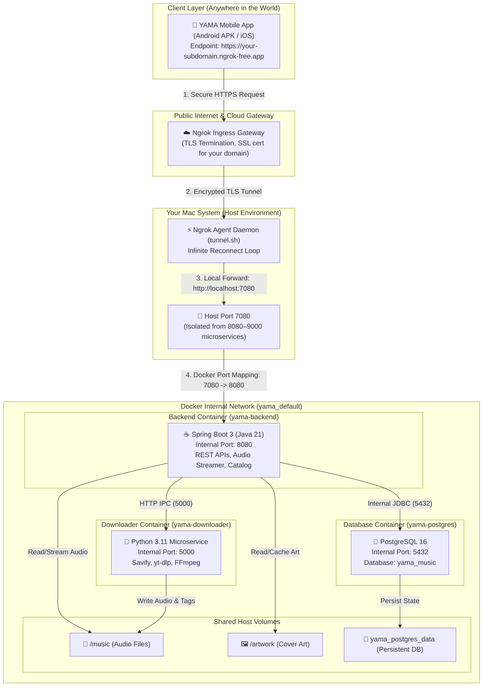

# YAMA System Architecture & Ngrok Tunnel Documentation

This guide provides a comprehensive technical overview of the **YAMA (Yet Another Music App)** backend architecture, how it is exposed to the internet using a permanent ngrok domain (e.g., `https://your-subdomain.ngrok-free.app`), and how the 1-tap start/stop launchers work.

---

## 1. High-Level System Architecture



---

## 2. How the Backend Uses the Permanent Domain

### The Request Lifecycle

1. **Mobile App Request**:
   The mobile client connects either to your local LAN (`http://<mac-ip>:7080`) or to your configured permanent tunnel URL:
   ```ts
   export const DEFAULT_API_URL = 'http://localhost:7080';
   ```
   When you search a track, request a stream, or browse playlists, the phone sends an HTTPS request to your configured endpoint (e.g. `https://your-subdomain.ngrok-free.app/api/...`).

2. **Ngrok Cloud Ingress**:
   The request hits Ngrok's public edge server. Ngrok handles TLS termination (valid SSL certificate) and routes the traffic directly to the registered active tunnel agent running on your Mac.

3. **Ngrok Local Agent (`tunnel.sh`)**:
   Your local ngrok agent receives the packets over the persistent connection and proxies them locally to `http://localhost:7080`.

4. **Docker Host Port Mapping (`7080:8080`)**:
   Docker forwards host port `7080` to container port `8080` of `yama-backend`.

5. **Spring Boot Backend Processing**:
   `yama-backend` receives the standard HTTP request, queries PostgreSQL (`postgres:5432`), orchestrates tasks with `downloader:5000`, or streams audio directly from the `/music` volume. The response flows back through the tunnel to the mobile phone.

### Why Port 7080 Was Chosen
- Your system reserves ports **8080 through 9000** for other project microservices.
- YAMA now binds strictly to **7080** on the host (`0.0.0.0:7080`), ensuring **zero port collisions**.
- Inside the Docker network, Spring Boot still runs on port 8080 without affecting your host.

---

## 3. The 1-Tap Control Launchers

Two unified 1-tap launchers are placed in your project root so you can start or stop the entire stack (Backend + Database + Downloader + Infinite Ngrok Tunnel) with a single double-click:

| Launcher | What It Does |
| :--- | :--- |
| [**`start.command`**](file:///Users/karan/My%20Files/Project%20Universe/YAMA%20(Yet%20Another%20Music%20App)/start.command) | **1-Tap Complete Launch**: Starts Docker containers (Backend, Postgres, Downloader), waits for healthcheck, and starts the infinite ngrok tunnel locked to `yama-backend.ngrok-free.app`. |
| [**`stop.command`**](file:///Users/karan/My%20Files/Project%20Universe/YAMA%20(Yet%20Another%20Music%20App)/stop.command) | **1-Tap Complete Shutdown**: Cleanly stops both the ngrok tunnel and all YAMA Docker containers. |

> [!TIP]
> On macOS, double-click `start.command` in Finder to launch everything. You can drag `start.command` and `stop.command` to your Desktop or macOS Dock for 1-click access!

---

## 4. The Infinite Reconnect Loop (`tunnel.sh`)

Free or development tunnels can disconnect if your Wi-Fi resets, your laptop sleeps, or the network drops. The `tunnel.sh` script solves this by running an **infinite self-healing loop**:

```bash
while true; do
    echo "Starting ngrok tunnel to port 7080..."
    ngrok http 7080 --url "https://yama-backend.ngrok-free.app" --log "ngrok.log"
    echo "Process disconnected. Reconnecting in 3 seconds..."
    sleep 3
done
```

- **Permanent Subdomain Lock**: `--url https://yama-backend.ngrok-free.app` guarantees your URL never changes.
- **Auto Reconnection**: If connection drops, it automatically re-establishes within 3 seconds.
- **Background Daemon Mode**: Running with `--daemon` or through `./server.sh tunnel-bg` detaches the process and writes its PID to `ngrok.pid`.

---

## 5. CLI Command Reference

If you prefer using the terminal, you can run all operations from `music-server`:

```bash
cd "music-server"

# 1. Start the Docker containers
./server.sh start

# 2. Start the Infinite Ngrok Tunnel in foreground (with live traffic logs)
./server.sh tunnel

# 3. Or start the tunnel in the background (daemon)
./server.sh tunnel-bg

# 4. Check status of server & tunnel
./server.sh status

# 5. Stop the background tunnel daemon
./server.sh tunnel-stop

# 6. Stop the Docker server
./server.sh stop
```

---

## 6. Live Inspection & Monitoring

- **Ngrok Web Inspector**: Whenever ngrok is running, visit **[http://localhost:4040](http://localhost:4040)** in your browser to see:
  - Every HTTP request made by the mobile app in real time.
  - Headers, payloads, response status codes, and execution latency.
  - The ability to replay any request for instant debugging.
- **Backend Healthcheck**:
  ```bash
  curl -i http://localhost:7080/api/health
  # Or via the tunnel:
  curl -i https://yama-backend.ngrok-free.app/api/health
  ```
